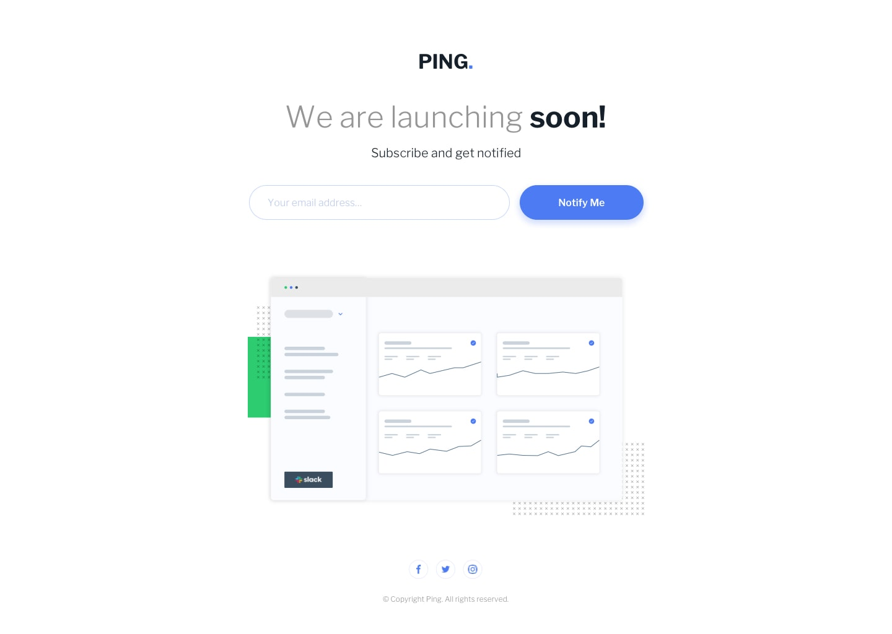
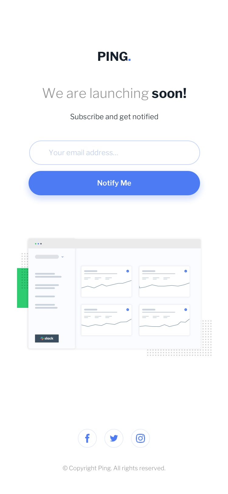

# Ping | Página de lançamento

Página responsiva de "em breve" para o Ping. A interface apresenta a marca, uma prévia do dashboard e um formulário para visitantes demonstrarem interesse em receber novidades.

## Prévia

### Desktop



### Mobile



### Ilustração do produto


As imagens de desktop e mobile acima são referências visuais incluídas no projeto. A ilustração do dashboard é o asset usado na página.

## Tecnologias

- React 19 e TypeScript
- Vite 8
- Tailwind CSS 4, integrado pelo plugin `@tailwindcss/vite`
- `tailwind-variants` para variantes e slots de estilo
- Oxlint para lint
- Libre Franklin como fonte da interface

## Requisitos

- Node.js 20.19+ ou 22.12+
- npm

## Começar

Instale as dependências:

```sh
npm install
```

Inicie o servidor de desenvolvimento:

```sh
npm run dev
```

O Vite mostrará no terminal a URL local, normalmente `http://localhost:5173/`.

## Comandos

| Comando             | Descrição                                                    |
| ------------------- | ------------------------------------------------------------ |
| `npm run dev`       | Inicia o servidor de desenvolvimento com atualização rápida. |
| `npm run typecheck` | Verifica os tipos TypeScript sem gerar arquivos.             |
| `npm run lint`      | Executa o Oxlint.                                            |
| `npm run build`     | Verifica os tipos e gera a versão de produção em `dist/`.    |
| `npm run preview`   | Serve localmente o build de produção.                        |

## Funcionalidade da página

- Exibe a marca Ping, o título, o formulário e a ilustração do dashboard.
- Em telas menores que 601 px, o campo e o botão ficam empilhados; em telas maiores, ficam lado a lado.
- O campo valida emails com as regras HTML de `type="email"` e `required`; a validação é apresentada pelo próprio formulário, em vez do aviso nativo do navegador.
- Os links sociais estão no rodapé.

### Estados de validação do formulário

1. **Inicial:** campo com borda azul-clara e sem mensagem de erro.
2. **Email ausente ou inválido:** ao selecionar **Notify Me**, o campo recebe borda vermelha, foco e a mensagem _“Please provide a valid email address”_ abaixo dele. O erro também é associado ao campo por `aria-invalid` e `aria-describedby`.
3. **Correção:** quando o valor passa a ser um email válido, a mensagem e a borda de erro são removidas.
4. **Envio válido:** a página exibe _“Thanks! We will notify you when we launch.”_ como mensagem de status acessível (`role="status"`).

**Limite atual:** o formulário é apenas demonstrativo. O envio não chama uma API, não cadastra emails e não persiste dados. Os links sociais também devem ser atualizados para os perfis oficiais antes da publicação.

## Componentes reutilizáveis

Os componentes estão em `src/components/` e aceitam propriedades HTML nativas do elemento correspondente.

### `Button`

Botão tipado com as propriedades padrão de um `<button>` e variantes de aparência e tamanho.

| Propriedade | Valores                     | Padrão    |
| ----------- | --------------------------- | --------- |
| `variant`   | `primary`, `secondary`      | `primary` |
| `size`      | `medium`, `large`           | `medium`  |
| `className` | Classes Tailwind adicionais | —         |

```tsx
<Button type="submit" variant="primary" size="medium">
  Notify Me
</Button>
```

### `Input`

Campo com label visualmente oculto, mas disponível para leitores de tela. A propriedade `error` aplica o estado visual de erro, define `aria-invalid` e associa a mensagem por `aria-describedby`.

| Propriedade | Descrição                                                 |
| ----------- | --------------------------------------------------------- |
| `id`        | Identificador do campo; obrigatório e associado ao label. |
| `label`     | Nome acessível do campo; obrigatório.                     |
| `error`     | Mensagem opcional de erro.                                |
| `size`      | `medium` (padrão) ou `large`.                             |
| `className` | Classes Tailwind adicionais para o controle.              |

```tsx
<Input
  id="email"
  name="email"
  type="email"
  label="Seu email"
  placeholder="voce@exemplo.com"
  required
/>
```

### `Text`

Componente tipado para texto com elemento semântico configurável pela propriedade `as`.

| Propriedade | Valores                           | Padrão |
| ----------- | --------------------------------- | ------ |
| `as`        | Elemento HTML ou componente React | `p`    |
| `variant`   | `title`, `body`, `caption`        | `body` |
| `className` | Classes Tailwind adicionais       | —      |

```tsx
<Text as="h1" variant="title">
  We are launching soon!
</Text>
```

## Estilos e variantes

O Tailwind é carregado em `src/index.css`. A seção `@theme` define os tokens da marca: azul principal, azul claro, vermelho, cinza, cor de texto e fonte. Para manter estilos próximos dos componentes:

- `Button.tsx` define variantes de aparência e tamanho com `tv()`.
- `Input.tsx` usa slots e variantes para estados, tamanhos, label e mensagem de erro.
- `Text.tsx` define variantes tipográficas.
- `src/styles/page.styles.ts` centraliza slots do layout e a variante de formulário `inline` ou `stacked`.

Para incluir uma classe adicional, use `className`; para uma opção reutilizável, prefira acrescentar uma variante em `tv()`.

## Estrutura do projeto

```text
.
├── index.html
├── src/
│   ├── App.tsx
│   ├── main.tsx
│   ├── index.css
│   ├── components/
│   │   ├── Button.tsx
│   │   ├── Input.tsx
│   │   └── Text.tsx
│   ├── styles/
│   │   └── page.styles.ts
│   └── assets/
│       ├── design/
│       └── images/
├── style-guide.md
├── tsconfig.json
└── vite.config.js
```

## Assets e referência

- `src/assets/images/logo.svg`: marca Ping.
- `src/assets/images/illustration-dashboard.png`: ilustração exibida pela página.
- `src/assets/images/favicon-32x32.png`: favicon.
- `src/assets/design/`: referências desktop, mobile e estados de erro.
- `style-guide.md`: cores e tipografia de referência do projeto.

## Contato

Entre em contato ou acompanhe meu trabalho:

- **Nome:** Francisco Rosendo
- **E-mail:** [rosendc30@gmail.com](mailto:rosendc30@gmail.com)
- **GitHub:** [github.com/rosendo2015](https://github.com/rosendo2015)
- **LinkedIn:** [linkedin.com/in/francisco-rosendo-coelho](https://www.linkedin.com/in/francisco-rosendo-coelho/)
